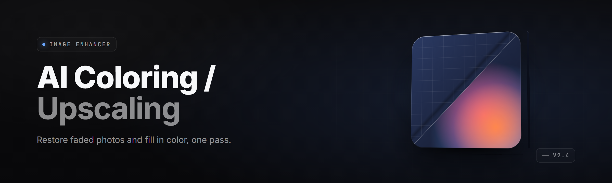

  
  
  

  

  
  
  

---

---

## 🎨 Overview

**ai-colorizer-upscale-studio** is a Windows desktop AI coloring and upscaling studio — drop in a black-and-white photo, a washed-out scan, or a low-res thumbnail and the app colorizes, denoises, and enlarges it in one pass. Everything runs locally on your GPU. No accounts, no cloud uploads, no monthly fee.

| Category | Details |
|---|---|
| Type | Offline desktop colorizer + upscaler .exe |
| Models | Diffusion colorization + ESRGAN-class super-resolution |
| Processing | Local (CPU fallback, CUDA / DirectML GPU) |
| Input Lores | JPG, PNG, WEBP, BMP, TIFF, HEIC |
| Output | PNG / JPG / WEBP at 1×–8× scale |
| Batch | Folder queue + recursive subfolders |
| Batch Faces | Dedicated face restore pass for small portraits |
| Tiling | Sliding-window tiling for large images on low VRAM |
| Year | 2026 release build |

If the source image is a scanned family photo from 1974, you get it back in color and sharpened at up to 8× while the original stays untouched. The two AI stages are stacked and tuned so the color pass doesn't fight the upscale pass — the network sees a denoised base, then a sharpened, color-consistent render comes out.

## 📦 Download

  

---

  

## 🧰 Is it safe? Do I need an account?

**Q:** Is this safe to run?
**A:** It ships as a signed Windows .exe that does all work offline. The only network touch is an optional one-time model file check you can disable in Settings.

**Q:** Do I need an account or subscription?
**A:** No account, no login, no subscription. Extract the folder, double-click the .exe, done.

**Q:** Does it upload my images anywhere?
**A:** Never. All colorization and upscaling runs on your machine. Nothing leaves disk unless you export it.</parameter>

**Q:** Will it work on an old laptop without a dedicated GPU?
**A:** Yes, on CPU fallback — slower, but every stage has a CPU path. A card with 6 GB+ VRAM makes it pleasant.

**Q:** Can I batch a whole folder of scans overnight?
**A:** Yes. Point it at a folder, pick an output preset, hit Queue. It recurses subfolders and skips anything unreadable.

**Q:** Does it overwrite my originals?
**A:** No. Sources are opened read-only. Output naming never collides with inputs.

**Q:** Can I just drop a file on the window?
**A:** Yes — drag and drop onto the canvas loads it instantly.

**Q:** Does it handle faces well?
**A:** Real photographs with recognizable subjects come out well. The face restore pass rebuilds identity from surrounding hair, skin, and occlusions.

## 🎞️ What is AI coloring / upscaling?

| Term | Explanation |
|---|---|
| **Colorization pass** | A diffusion model that infers plausible color from luminance + semantic context. |
| **Upscale pass** | A super-resolution network that reconstructs texture and edge detail at higher resolution. |
| **Tiling** | Splitting a large image into overlapping windows so VRAM stays bounded; tiles are seamed back. |
| **Face restore** | A second model focused on compact facial crops so upscaled portraits stay recognizable. |
| **Denoise pre-pass** | Removes scan grain and JPEG blocking before the colorizer sees it. |
| **Preset** | A saved bundle of stages, strengths, and scale for a repeatable look. |
| **Alpha-safe** | Transparent PNG regions are preserved through both passes. |

- Recovers believable skin tones, fabric dye, and foliage color from grayscale.
- Reconstructs eyebrow hair, eyelashes, and skin pores the source never had.
- Strips sensor noise and film grain before reconstruction so detail stays clean.
- Output is non-destructive: sources and exports live in separate folders.
- Fully local, resumable batch queue — kill it and it picks the queue back up.

---

## ⚙️ System Requirements

| Component | Minimum | Recommended |
|---|---|---|
| OS | Windows 10 21H2 (x64) | Windows 11 23H2 (x64) |
| CPU | 4-core x64, AVX2 | 8-core x64, AVX-512 |
| RAM | 8 GB | 16–32 GB |
| GPU | DirectX 12 integrated | NVIDIA RTX 20-series+ / RDNA2+ |
| VRAM | 2 GB (tiling) | 8 GB+ |
| Disk | 4 GB free | 12 GB free (model cache + exports) |

## 🧩 Does it work on odd formats?

**Q:** Will it open very large images?
**A:** Yes — images up to 30,000 px on either edge are auto-tiled.

**Q:** Does it support multi-page TIFFs or PDFs?
**A:** Single-frame image formats only. Split pages first, then queue the folder.

**Q:** Can I upscale an already colorized image without recoloring it?
**A:** Yes — disable the colorizer stage in the Stage list, keep the upscaler.

**Q:** What about animated frames?
**A:** Frame-by-frame processing works (export as PNG sequence then reassemble).

---

## 🛠️ Grouped module catalog

### 🖼️ Colorization
| Module | Status | Description |
|---|---|---|
| `colorizer-diffusion-v3` | ✅ Working | Per-image color inference with 5 strength levels. |
| `colorizer-palette-lock` | ✅ Working | Reference-mode: pull a target palette from an example photo. |
| `colorizer-region-prompt` | ✅ Working | Box-drag a region and describe its intended color. |
| `colorizer-alpha-safe` | ✅ Working | Flows through transparent pixels without tinting edges. |
| `colorizer-histogram-calib` | ✅ Working | Calibrates warm/cool bias automatically across a batch. |

### 🔍 Upscaling
| Module | Status | Description |
|---|---|---|
| `upscale-esrgan-x4` | ✅ Working | General-purpose 4× super-resolution. |
| `upscale-esrgan-x8` | ✅ Working | 8× for archival posters and billboard mockups. |
| `upscale-anime-2x` | ✅ Working | Lineart-optimized reconstruction for illustration. |
| `upscale-face-patch` | ✅ Working | Focused portrait refinement pass. |
| `upscale-grain-match` | ✅ Working | Tunes output grain to taste from smooth to filmic. |

### 🎛️ Batch & Workflow
| Module | Status | Description |
|---|---|---|
| `batch-folder-walk` | ✅ Working | Recursive input scan with skip-on-error. |
| `batch-resumable-queue` | ✅ Working | Persists the queue across restarts. |
| `batch-preset-apply` | ✅ Working | Apply a preset set to an entire batch. |
| `batch-export-namer` | ✅ Working | Pattern-based naming: `{stem}_{scale}_{stage}.png`. |
| `batch-sidecar-metadata` | ✅ Working | Writes a `.json` sidecar with every applied setting. |

### 🖥️ Interface
| Module | Status | Description |
|---|---|---|
| `ui-drop-canvas` | ✅ Working | Drag-and-drop target with before/after split view. |
| `ui-split-slider` | ✅ Working | Flip a slider to compare source and output at pixel-level. |
| `ui-preset-panel` | ✅ Working | Save, load, and duplicate presets. |
| `ui-batch-queue-panel` | ✅ Working | Queue control with pause / resume / prioritize. |
| `ui-history-strip` | ✅ Working | Last 100 sessions recoverable. |

### 🎨 Output
| Module | Status | Description |
|---|---|---|
| `output-scale-matrix` | ✅ Working | 1×, 2×, 3×, 4×, 6×, 8× — single-sweep resample. |
| `output-color-profile` | ✅ Working | sRGB / Display-P3 / Adobe RGB tagging. |
| `output-bitdepth-toggle` | ✅ Working | 8-bit or 16-bit PNG export. |
| `output-metadata-preserve` | ✅ Working | Optional EXIF round-trip. |
| `output-checksum-verify` | ✅ Working | SHA-256 written next to exports. |

### 🧠 Model Registry
| Module | Status | Description |
|---|---|---|
| `model-auto-download` | ✅ Working | Fetch extra presets on first use from the model index. |
| `model-integrity-check` | ✅ Working | Re-verifies each model blob before a run. |
| `model-variant-select` | ✅ Working | Fast / Balanced / Quality per model. |
| `model-router-config` | ✅ Working | Views what the app computed for the run. |

### 🧪 Diagnostics
| Module | Status | Description |
|---|---|---|
| `diag-dtype-inspector` | ✅ Working | Shows half / full precision chosen per stage. |
| `diag-vram-tiles-view` | ✅ Working | Visualizes the tiling grid and seam overlap. |
| `diag-error-pack` | ✅ Working | One-click bundle of logs, GPUs, drivers, and versions. |

## ✨ Key Features — What's actually inside

| Feature | Description | Benefit |
|---|---|---|
| One-pass colorizer + upscaler | Two stages chained without double-processing | Fast and consistent results |
| Local-only AI | No network calls for inference | Private by default |
| CUDA + DirectML + CPU | Every stage runs on every path | Works almost anywhere |
| Lores bump 1×–8× | Six scale steps from mild to archival | One tool for thumbnails and prints |
| Recursive batch & resumable queue | Point at a folder, walk away | Fits long overnight runs |
| Non-destructive originals | Sources never modified | No rescue needed |
| Face restore for shrinking portraits | Rebuilds identity from context | Family photos come back recognizable |
| Sliding-window tiling | Big images on modest VRAM | Runs on laptops with 2 GB |
| Split-view and slider compare | Before / after with precision | You see exactly what changed |
| Preset panel | Save repeatable looks | Consistent color across a campaign |
| Alpha preservation | Transparent areas stay transparent | UI assets render cleanly |
| Sidecar metadata | Every job documented | Auditable and repeatable |

## 🛰️ Which formats will it eat?

| Format | Read | Colorize | Upscale | Export |
|---|---|---|---|---|
| JPG | ✅ | ✅ | ✅ | ✅ |
| PNG (incl. alpha) | ✅ | ✅ | ✅ | ✅ |
| WEBP | ✅ | ✅ | ✅ | ✅ |
| BMP | ✅ | ✅ | ✅ | ✅ |
| TIFF (16-bit) | ✅ | ✅ | ✅ | ✅ |
| HEIC | ✅ | ✅ | ✅ | ✅ |
| RAW (CR3, NEF, ARW) | ✅ | ✅ | ✅ | ✅ (via embedded preview) |

---

## 🎯 Does the workflow match what I already do?

**Q:** I already own a stack of Photoshop actions. Why use this?
**A:** Because two AI stages chained inside one app keep color and detail consistent, no hot soup of layers needed.

**Q:** Can I run it as just an upscaler?
**A:** Yes — turn the colorizer stage off and keep the upscaler on.

**Q:** Does it Photoshop-fill the colors into already processed files?
**A:** No — inputs are always treated as new candidates.

## 💥 The problem this thing actually solves

- Old photos and prints come back gray unless a human carefully paints every region.
- Web and PDF illustrations arrive at 512 px and blur when scaled up.
- Cheap "enhance" knobs hallucinate details that weren't there, then everyone argues about what the photo really showed.
- Cloud colorize tools charge by image and only give you batch after a credit card.
- Online services store your uploads on someone else's drive forever.
- Plain super-resolution tools skip the color pass entirely.
- Good open models ship with shell scripts, requiring Python and a terminal before you see one result.
- Cross-tool chaining forces float clamping errors between colorization and upscaling.

## 🩹 The Solution

| Problem | Solution |
|---|---|
| Gray photos | Diffusion colorizer with per-region strength control and palette locks. |
| Blurry thumbnails | X4 / X8 super-resolution with anime-aware and photo-aware variants. |
| Hallucinated detail | Semantic-stable diffusion pass plus non-hallucinating reconstruction limits, both tunable. |
| Paid per-image cloud | Fully local .exe, one download, no per-image bill. |
| Stored uploads | No upload paths — inference is local only. |
| Skippable AI chaining | Colorizer and upscaler are stacked and normalized between stages. |
| Hidden tools | Results in a split-view compared to source — no guessing. |
| Batch chaos | Recursive folder walk, resumable queue, preset-per-batch. |

## ⚡ Quick Start — the whole handhold

1. 🎁 Visit the project page → hit **

  

** → save the release `.exe` and companion model pack.
2. 📦 Extract the `.rar`/`.zip` to a normal folder (e.g. `C:\AI-Colorizer-Upscale-Studio`). Do not run the `.exe` from inside the archive.
3. 🖱️ Right-click the `.exe` → **Run as administrator** on first launch so the DirectML shim installs cleanly.
4. 🖼️ Drag a JPG/PNG onto the canvas, pick a preset (**Natural Photo**, **Portrait Restore**, **Anime Illustration**, **Archival Print**), choose scale (1×–8×), and hit Run.
5. 📤 When satisfied, use **Export** for a single file or **Queue → Export folder** for the batch result. Every file in the queue is stamped next to its sidecar.

## 🎚️ Tips for best results

- Set colorizer strength to 60 % for family photos, not 100 % — oversaturation looks fake.
- Turn on **Face Restore** for portraits smaller than 200 px wide.
- For lineart, use the Anime 2× model, upscale height tiers from small to large, then combine.
- Run the color pass **before** the upscale pass — swapping the order mangles micro-texture.
- Drop the Denoise strength for scanned film with visible silver and halide — over-cleaning eats grain.
- Use a preset for repeatable color temperature across a wedding batch.
- Inspect the seam finder after the first tiled render — heavy recursion on tiny VRAM can hide a stitch.

## 🧪 Doesn't it freak your SSD?

**Q:** Large batch — will it fill my disk?
**A:** 16-bit PNGs are fat (roughly 40 MB per 4× file). Export to JPG or WEBP for storage stress, keep PNG for post-edit.

**Q:** Is the model cache updateable?
**A:** Yes — the Registry panel can refresh additional presets without reinstalling the app.

**Q:** Can I export 8-bit and 16-bit together?
**A:** Yes — export targets are multiples.

## 🔧 Known Issues

| Issue | Fix |
|---|---|
| Upscale stalls on 3090 with `VRAM allocation failed` | Reduce max tile size to 1024 in Settings → Performance, or lower to 2× then re-run. |
| Colorized skin looks overcooked on scan originals | Turn **auto color-profile** off for scanned film — the histogram calibration overcompensates. |
| 8× on very large source hangs without progress | Disable tiling for that job; 30K+px × 8× sources should be split into quads. |
| Export metadata missing ACES / color tag | Use **Export → With Profile** — not the Drag-to-Explorer export — for tagged output. |

## 🔗 Daily checks & alerts

**Q:** Does it auto-update?
**A:** Only if enabled in Settings → Updates. Otherwise it stays a frozen build for reproducibility.

**Q:** Can I schedule a night batch?
**A:** Cron-equivalent built-in: Startup batch, one-shot batch schedule, then mirror-folder as needed.

---

> Every run is a self-contained signed build. The model cache indexes itself, the queue is persistent, and the fallback path stays non-destructive.

## 📚 Glossary (does that hold every drop of vocabulary for 'AI coloring / upscaling (image enhancer) generator')

| Term | Explanation |
|---|---|
| Colorize pass | Per-image color inference, driven by diffusion. |
| Diffusion model | The latent-denoise network used for color fiction. |
| Super-resolution | Networked upscaler that maps low → high resolution. |
| Tile | A chunk of an input, processed independently to fit VRAM. |
| Seam | The blend boundary between two tiles. |
| Face restore pass | Portrait-cell model applied after upscaling. |
| Registry | Model cache metadata service inside the app. |
| Preset | Persisted configuration for reproducible output. |
| Denoise strength | How aggressive the pre-clean of grain and blockiness is. |

That's the studio, chef. Two stages, one .exe, local for keeps — absolute potato to Sam. Name the next one. 6767.
